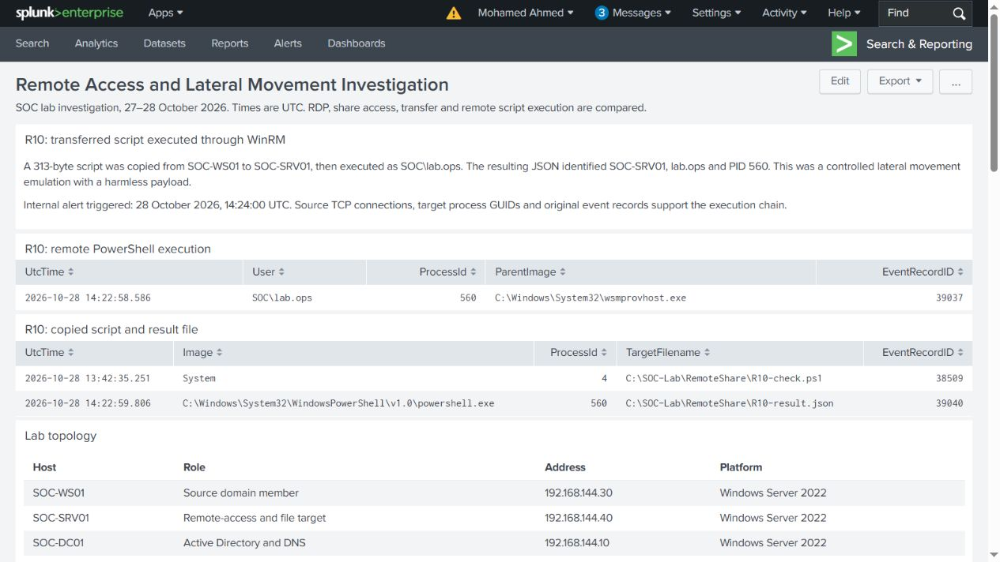
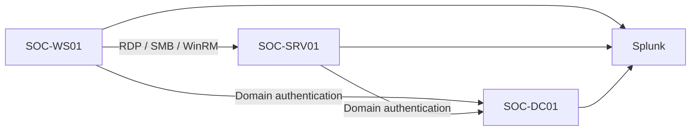

# Remote Access and Lateral Movement Investigation

Investigated a controlled lateral movement sequence from SOC-WS01 to SOC-SRV01: a script arrived over SMB, then ran through WinRM and created a result file on the target. A scheduled Splunk alert identified the execution. RDP, share permissions, transfer-only and identity-command cases provide the comparison context.

## Findings

- Confirmed execution of the transferred script as `SOC\lab.ops`: source connection, target WinRM host, PowerShell child, script logging and output file all matched. The harmless result recorded SOC-SRV01 and PID 560.
- The remote-script alert triggered on the fresh activity at 14:24 UTC on 28 October 2026. The final disposition was an authorized lateral movement emulation using a known lab account.

- RDP disconnect preserved session 2; reconnect returned to it, while Windows Sign out ended it.
- Both share accounts authenticated, but lab.user5 was denied access. Authentication and share authorization were separate outcomes.
- The copied text file matched on content, 60-byte length and SHA256. Target file creation was attributed to System.
- The WinRM command returned the target hostname and account. Target wsmprovhost and its hostname/whoami children were linked by native process identifiers.
- The dashboard and internal alert were created in Splunk and checked against original event records.

## Environment

| Host | Role | Address | Platform |
|---|---|---|---|
| SOC-DC01 | Active Directory and DNS | 192.168.144.10 | Windows Server 2022 |
| SOC-WS01 | Source domain member | 192.168.144.30 | Windows Server 2022 |
| SOC-SRV01 | Remote-access and file target | 192.168.144.40 | Windows Server 2022 |
| SOC-SIEM | Collection and investigation | 192.168.144.20 | Splunk Enterprise 9.4.1 |

Domain: `soc.test` (`SOC`). The three Windows systems forward events to the `lab_windows` index. The [Sysmon configuration](config/sysmon-lab.xml) covers process creation, lab network connections and test-file creation.

## Cases

| Case | Investigation |
|---|---|
| [R01](cases/R01/README.md) | Authorized administrative baseline |
| [R02](cases/R02/README.md) | RDP logon, disconnect, reconnect and sign-out |
| [R03](cases/R03/README.md) | Share access and permission comparison |
| [R04](cases/R04/README.md) | Harmless file transfer and hash verification |
| [R05](cases/R05/README.md) | Safe WinRM command and process correlation |
| [R06](cases/R06/README.md) | Account and privilege context |
| [R07](cases/R07/README.md) | Timeline and comparison controls |
| [R08](cases/R08/README.md) | Dashboard and tested internal alert |
| [R09](cases/R09/README.md) | Cleanup and retained evidence for R01–R08 |
| [R10](cases/R10/README.md) | Transferred script executed through WinRM and detected by a scheduled alert |

Windows interfaces were used for desktop checks, share access, text creation, copying and account inspection. Each WinRM case used one explicit Invoke-Command with interactive credentials. Searches each answer a specific investigation question; [query guide](docs/query-guide.md) explains the groups.

Original event XML, native record IDs, Search UI result CSVs and actual interface pictures are kept with each case. The [combined event index](evidence/event-index.csv) identifies unique host/channel/record tuples; [SHA256 manifest](SHA256SUMS.txt) covers the delivered files. Times are UTC.
