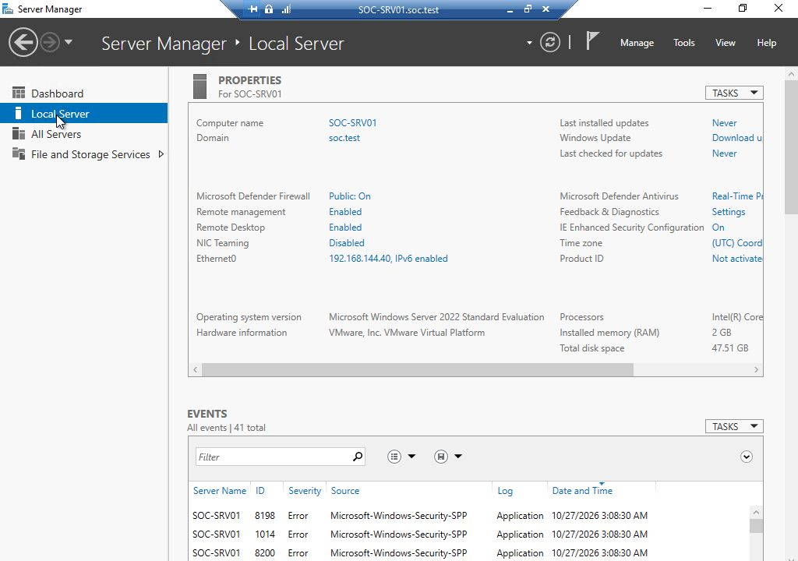
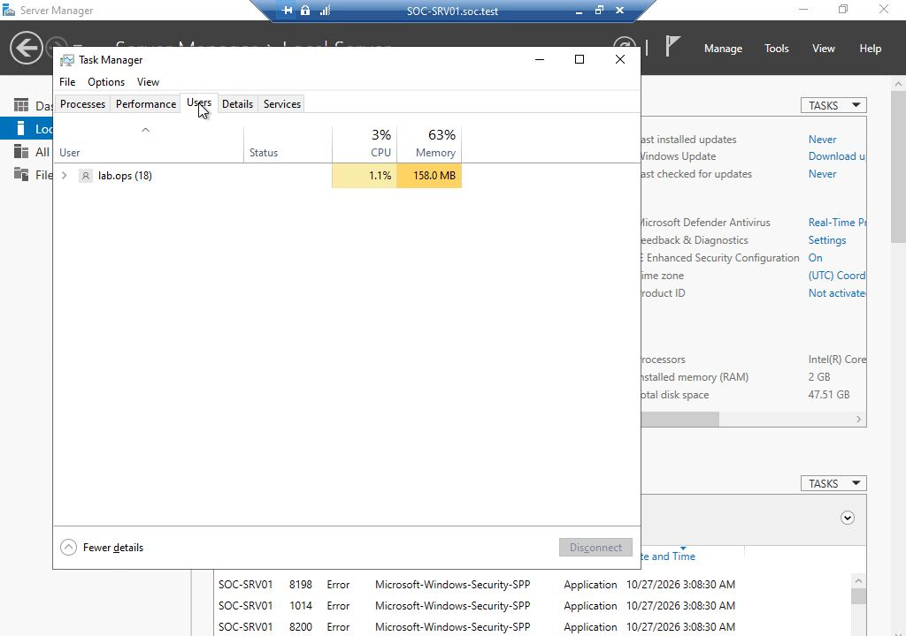
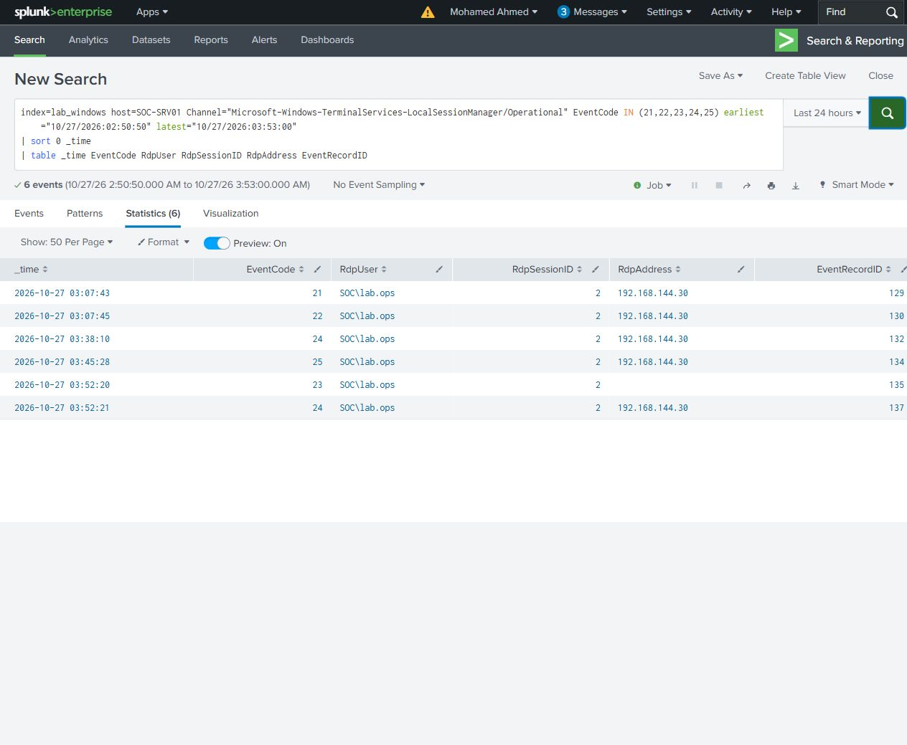

# RDP session investigation

An authorized administrative session connected SOC-WS01 (`192.168.144.30`) to SOC-SRV01 (`192.168.144.40`) as `SOC\lab.ops`. The account already belonged to the target local Administrators group through SOC-Lab-Operators; it was not a Domain Admin. The planned check was to confirm the target identity and account, then compare disconnect, reconnect and sign-out.

The connection used the Windows Remote Desktop client. Server Manager confirmed the target hostname, domain and address. Task Manager showed the signed-in account. No file transfer or remote command was part of this session check.

| Time (UTC, 27 October 2026) | Observation | Original records |
|---|---|---|
| 03:07:34 | RDP authentication and network logon | RCM 1149/39; Security 4624/24824, type 3 |
| 03:07:38–03:07:45 | Desktop logon and shell start | Security 4624/24840 and 24841, type 10; LSM 21/129 and 22/130, session 2 |
| 03:38:07–03:38:10 | Connection disconnected; session retained | Security 4779/25418; LSM 24/132 |
| 03:45:26–03:45:30 | Reconnected to session 2 | RCM 1149/42; Security 4778/25520; LSM 25/134; type 7 logon records |
| 03:52:19–03:52:21 | Windows Sign out ended the session | Security 4647/25604; LSM 23/135, followed by disconnect records |

The two initial type 10 records contain linked logon IDs; they belong to one desktop sign-in. Reconnection produced type 7 records rather than another initial type 10 desktop logon. The original desktop LogonId `0x1206041` appears in disconnect, reconnect and sign-out records on SOC-SRV01.

On the source, Sysmon recorded `mstsc.exe` launched by Explorer, with TCP and UDP connections to target port 3389. Its process ran as the source desktop account `SOC\Administrator`; explicit target credentials were `SOC\lab.ops`. ProcessGuid separates the initial client process from the reconnect client. Source and target LogonIds are interpreted locally to each host.

The three searches each answer one question: [successful logons](queries/R02-logons.spl), [session transitions](queries/R02-sessions.spl), and [RDP authentication](queries/R02-rdp-auth.spl). All 8, 6 and 2 respective result rows matched original event XML by host, channel and record ID.

This session provides the authorized desktop baseline for the later share, transfer and remote-command comparisons.
