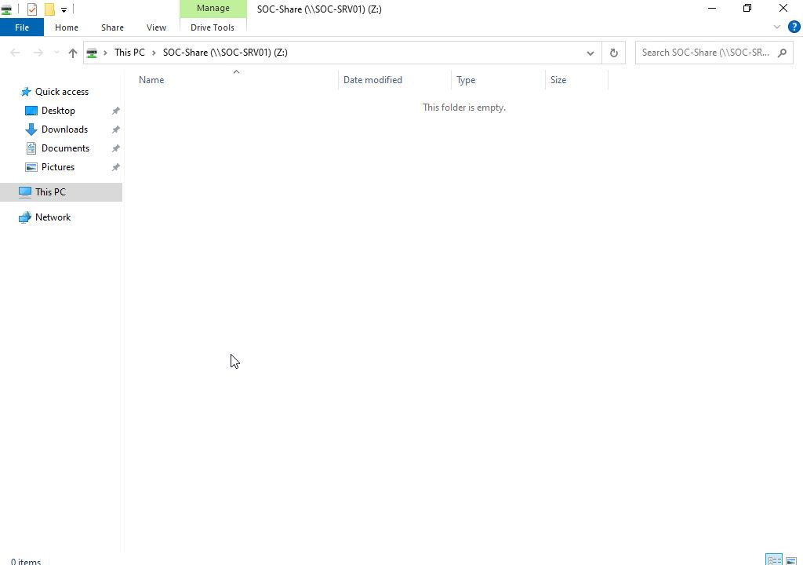
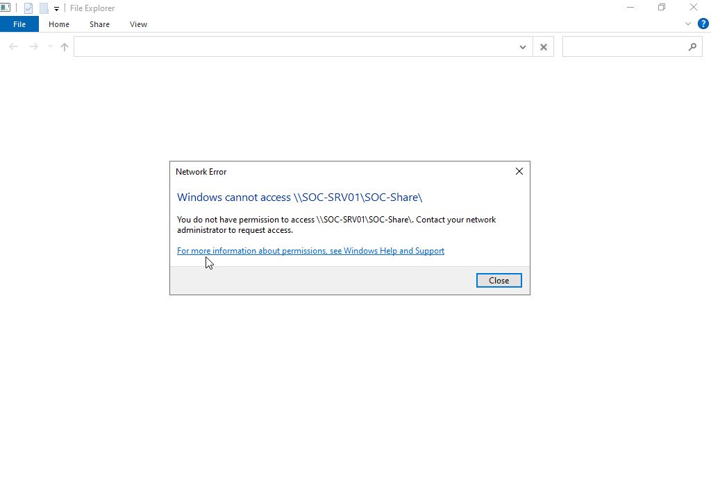
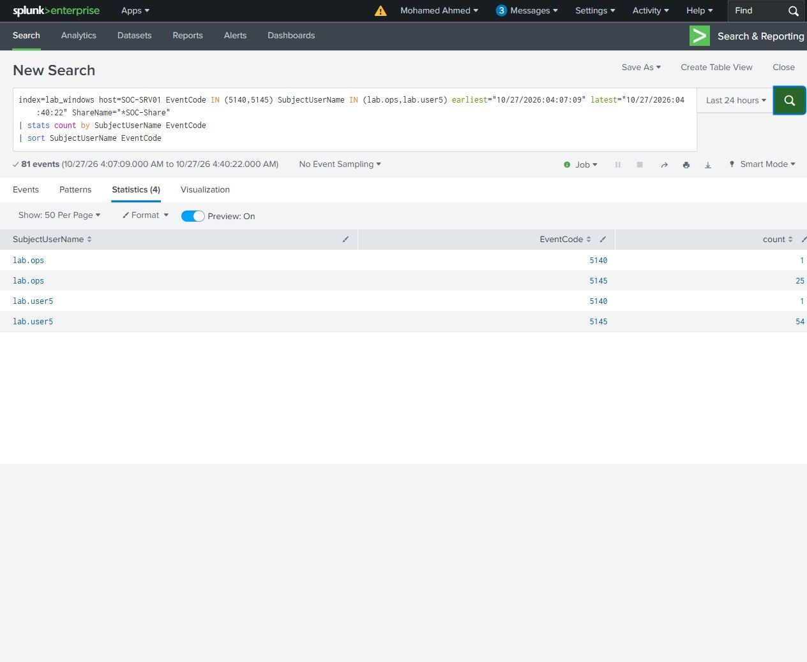

# Share access and authorization

SOC-WS01 connected to `\\SOC-SRV01\SOC-Share` through Explorer. The first connection used `SOC\lab.ops` and opened the empty share. The drive mapping was disconnected before the comparison account was used.

One correct-credential submission as `SOC\lab.user5` authenticated successfully but Explorer reported that the account did not have permission to access the share. The limited-account mapping was then disconnected.

| Account | Network logon on target | Explorer result | Detailed share checks |
|---|---|---|---|
| lab.ops | 4624/25899, type 3, 04:16:10 UTC | Empty folder opened | 25 audit-success records |
| lab.user5 | 4624/26093, type 3, 04:32:31 UTC | Access denied | 54 audit-failure records |

The target share allows Administrators and SOC-Lab-Share-Users. lab.ops is in both relevant groups; lab.user5 is a standard domain user without either share grant. The failed 5145 checks contain access-denied reasons consistent with that share permission difference. Native event keywords distinguish successful and failed audit records.

Each account also produced a 5140 record for SOC-Share. A 5140 record alone therefore did not establish successful folder access in this comparison. The single denied GUI attempt generated multiple access checks as Explorer queried the share; those are not 54 password attempts.

The [logon search](queries/R03-logons.spl) returned the two successful network logons. The [share summary](queries/R03-share-access.spl) returned four rows covering 5140/5145 counts by account. Both tables matched the original XML records. No file was copied during this stage.

