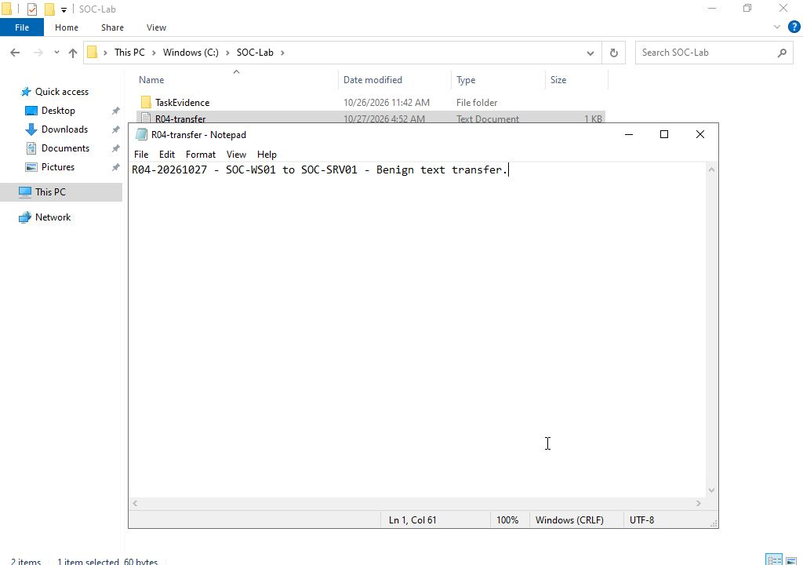
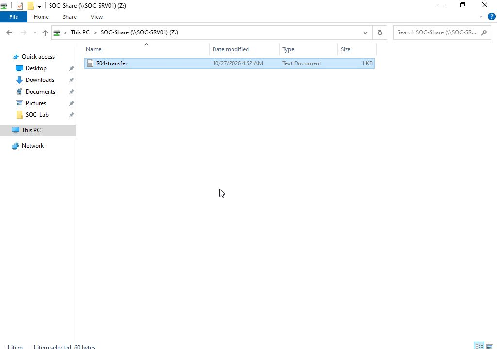
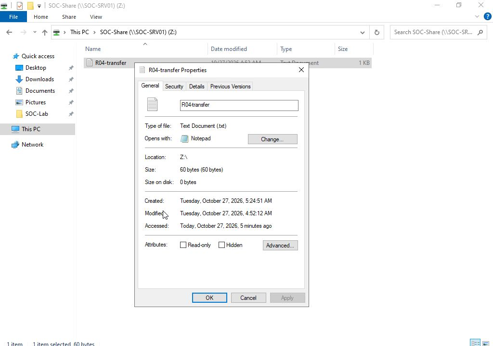
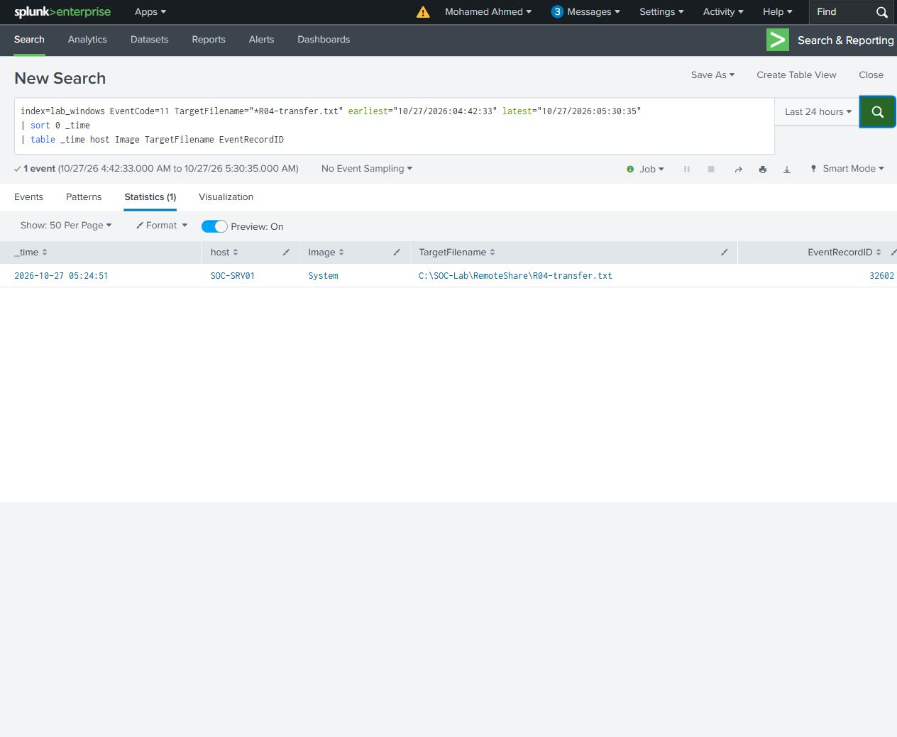

# Harmless file transfer

A 60-byte text file was created in Explorer on SOC-WS01, named `R04-transfer.txt`, and edited in Notepad. It contained a unique case marker and a short description of the transfer. The destination file was absent before the copy.



Explorer copied the file into `\\SOC-SRV01\SOC-Share` using `SOC\lab.ops`. The target path was `C:\SOC-Lab\RemoteShare\R04-transfer.txt`. The file was copied as data; it was not executed.





The source and target had identical contents, a length of 60 bytes and the same SHA256:

```text
1588017FEDC7ACD882637898E2E486F00E433026ED6EF86618993C5E99B92A13
```

The target creation time was 05:24:51 UTC on 27 October 2026. Its last-modified time remained 04:52:12 UTC from the source file. Matching modified times alone would not have established the transfer; the actual target file, matching hash, GUI result and event records support it together.

Sysmon recorded target file creation in event 11/32602, attributed to `System`. The source initial creation was recorded as `New Text Document.txt` in Sysmon 11/37631 before the GUI rename.

The [file creation search](queries/R04-file-events.spl) returned the target event. The [share access search](queries/R04-share-write.spl) grouped nine lab.ops access checks into seven rows, including a write-data request with mask `0x2`. The recorded upper/lowercase spellings refer to the same Windows filename. Two separate machine-account metadata checks remain in the original records and are not counted as lab.ops requests.

Both Search UI results matched original XML. [File verification](results/file-verification.csv) records the paths, sizes, hashes and timestamps; the [preserved text sample](files/R04-transfer.txt) has the same hash.


