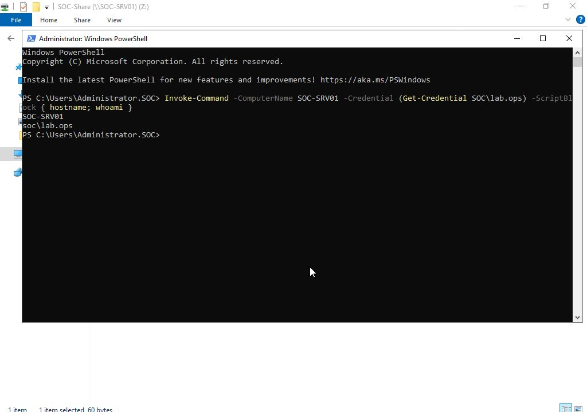
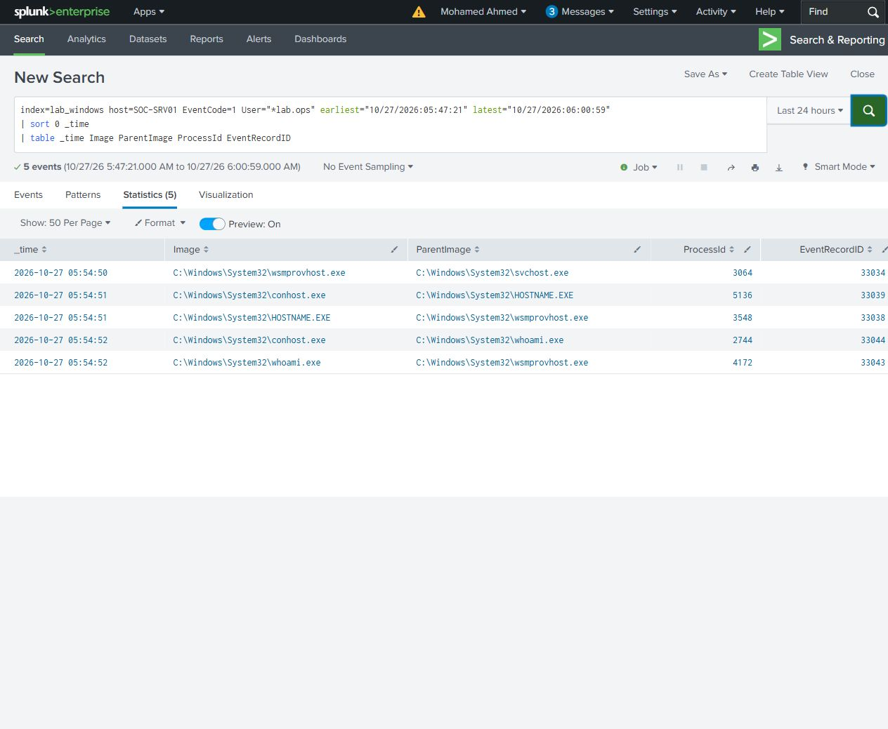

# Safe remote command over WinRM

From SOC-WS01, one explicit PowerShell command used interactive credentials for `SOC\lab.ops` to run `hostname` and `whoami` on SOC-SRV01:

```powershell
Invoke-Command -ComputerName SOC-SRV01 -Credential (Get-Credential SOC\lab.ops) -ScriptBlock { hostname; whoami }
```

The console returned `SOC-SRV01` and `soc\lab.ops`, then returned to the source prompt. The command did not create a marker or execute the transferred text file.



On the target, WinRM created `wsmprovhost.exe` with PID 3064. The hostname and whoami processes were children of that same ProcessGuid. PowerShell event 4104/2753 contained the actual `hostname; whoami` script block; WinRM event 91/194 recorded the PowerShell resource URI with the same process ID and account SID.

| Evidence | Original records |
|---|---|
| Source command text | SOC-WS01 PowerShell 4104/2848 |
| Source TCP connections to target port 5985 | SOC-WS01 Sysmon 3/38656–38659, client PID 3392 |
| Target network logon for execution context | SOC-SRV01 Security 4624/27139, local LogonId `0x177d34d` |
| WinRM host | SOC-SRV01 Sysmon 1/33034, PID 3064 |
| Hostname and whoami children | SOC-SRV01 Sysmon 1/33038 and 33043 |
| Target script text | SOC-SRV01 PowerShell 4104/2753 |
| WinRM PowerShell endpoint | SOC-SRV01 WinRM 91/194 |
| Host process termination | SOC-SRV01 Sysmon 5/33047 |

The target network logon records leave the address as `-`; the source network records provide the actual connection destination. Native ProcessGuid, ParentProcessGuid, account SID and target-local LogonId support the process/session link. The target command ran inside wsmprovhost.exe.

Four simple searches cover [target processes](queries/R05-target-processes.spl), [command text](queries/R05-command-text.spl), [source connections](queries/R05-source-connection.spl), and [target logons](queries/R05-network-logons.spl). All 16 result rows matched original XML. The WinRM host terminated after the one-off command completed.


