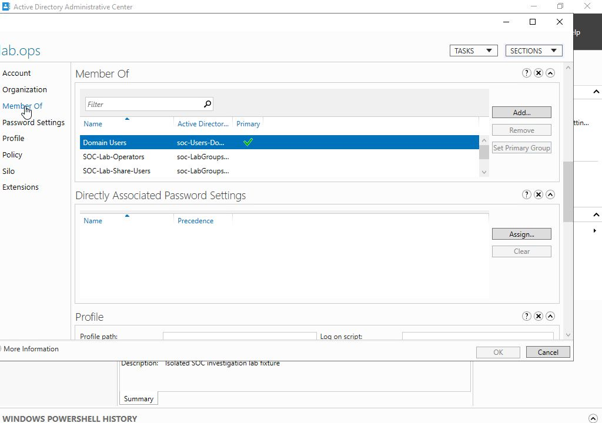
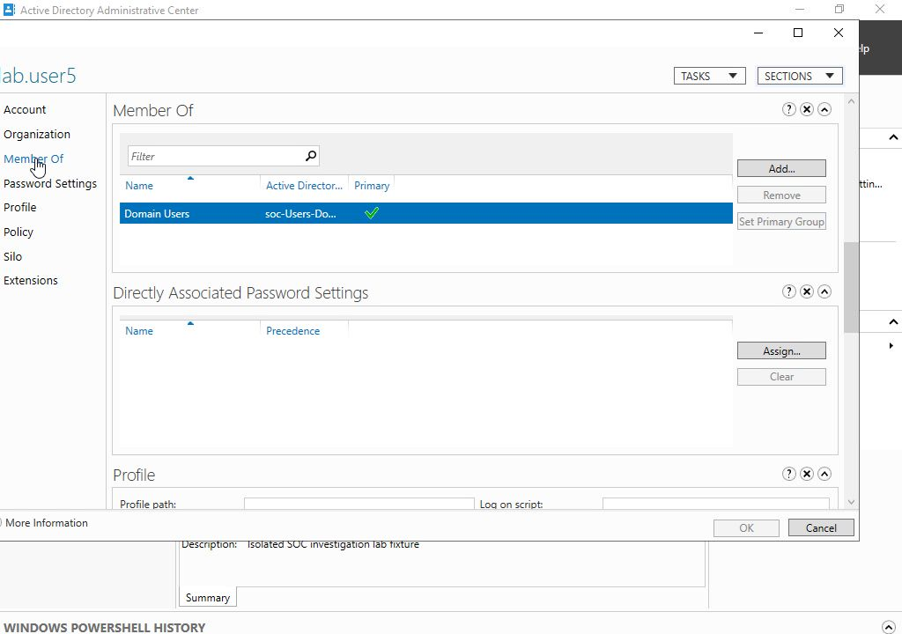
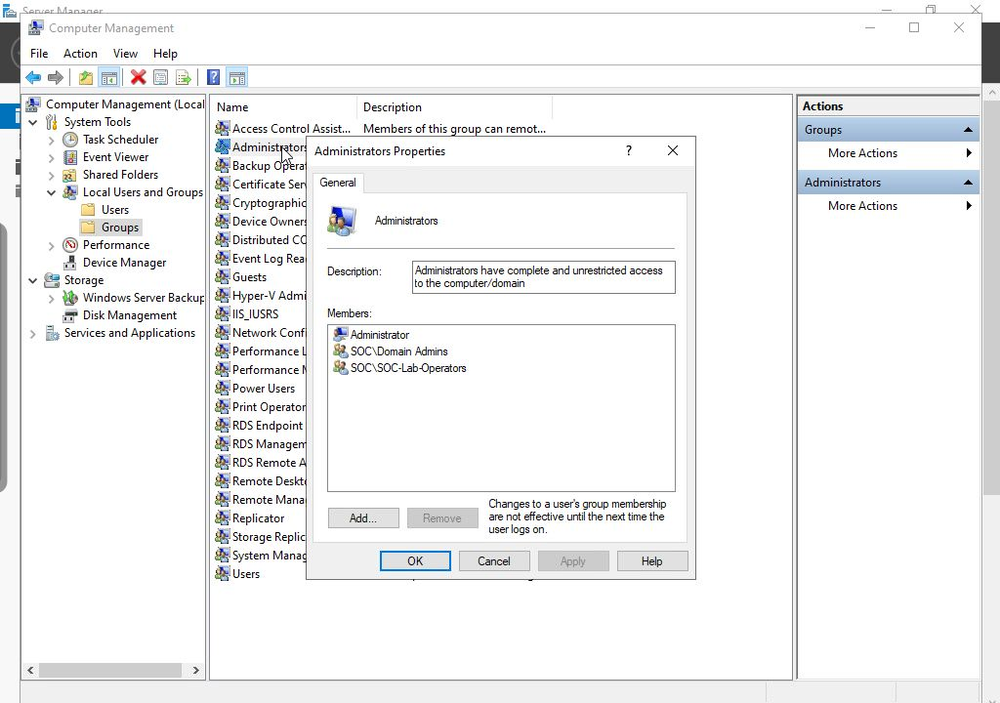

# Account and privilege context

Active Directory Administrative Center showed lab.ops in Domain Users, SOC-Lab-Operators and SOC-Lab-Share-Users. The comparison account lab.user5 belonged to Domain Users only.

Computer Management on SOC-SRV01 showed SOC-Lab-Operators in the local Administrators group. This explains lab.ops target-local administration; its domain memberships did not include Domain Admins. No group membership was changed for this investigation.

The [account table](results/account-context.csv) records the SIDs and groups. The [privilege-event search](queries/R06-privilege-events.spl) returned 12 target 4672 records that matched original XML. A 4672 record reports special privileges assigned to a logon; domain group membership was checked separately.
