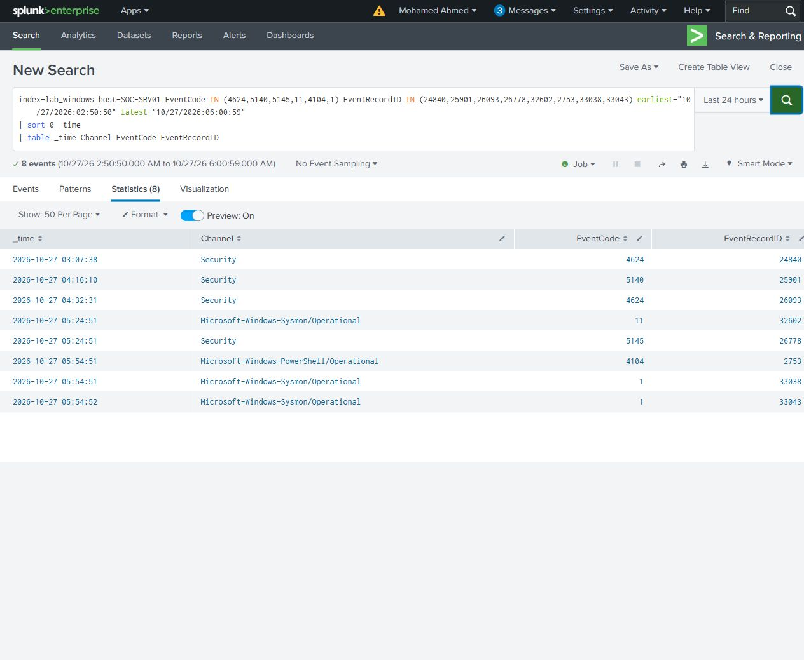

# Correlation and comparison controls

The investigation separated desktop access, share access, file transfer and command execution. [Comparison controls](results/comparison-controls.csv) record what occurred at each stage. The RDP baseline did not transfer a file. Opening the empty share did not copy one. The limited account authenticated but could not open the share. Copying the text file did not execute it. The later WinRM command independently ran hostname and whoami.

The [case-anchor search](queries/R07-evidence-anchors.spl) looks up eight selected records from the verified stages. It is an evidence lookup for this case, rather than a general detection rule. Host, channel and record ID identify each original event.

Within the target, Security LogonId links authentication and privilege context. ProcessGuid and ParentProcessGuid link the WinRM host and its children. Source network connections, target events, account and time support the cross-host sequence; a LogonId is not treated as a global identifier across machines.

The sequence was a controlled lab investigation with known permissions and a documented purpose. Familiar management protocols alone do not establish malicious activity; the account, source and authorization context determine the meaning of the sequence.
