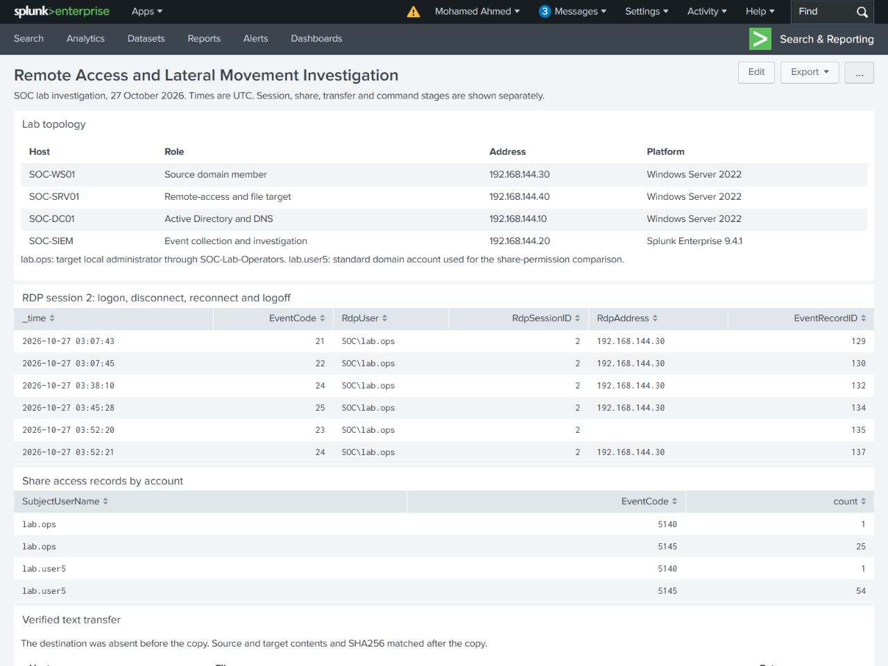
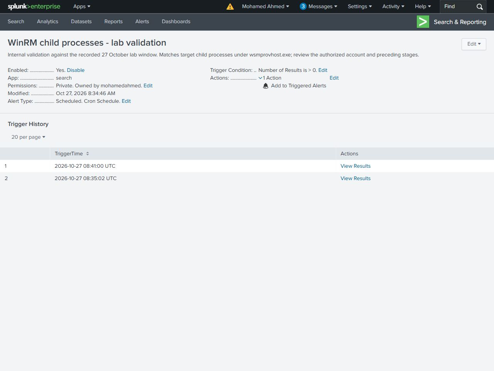
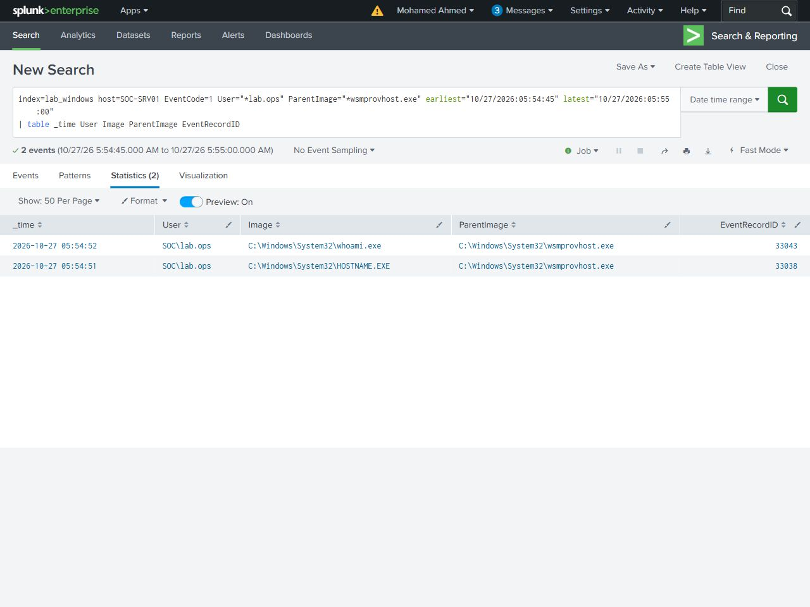

# Dashboard and internal alert

The saved Classic dashboard contains nine panels: lab topology, RDP session transitions, share records, the verified file comparison, target file creation, source WinRM connections, the target process chain, command text and phase controls. Its six search tables matched the previously verified Search UI results.

[Full dashboard image](screenshots/dashboard-full.jpg) · [Dashboard definition](../../dashboard/remote-access-investigation.xml)

The internal alert **WinRM child processes - lab validation** matched hostname.exe and whoami.exe under wsmprovhost.exe as lab.ops on SOC-SRV01. It evaluated the recorded 05:54:45–05:55:00 UTC lab window. The rule triggered when results were greater than zero, with one alert per evaluation and 300-second suppression. Its action added an entry to Triggered Alerts.

The UI showed trigger entries at 08:35:02 and 08:41:00 UTC on 27 October 2026. The scheduled 08:41 job was opened from that history and returned original Sysmon records 33038 and 33043. Its [two UI result rows](results/scheduled-job-ui-results.csv) matched native XML. These are results of the scheduled alert job, separate from the initial manual search.

Scheduling was stopped at 08:58:53 UTC after the results were saved. The [saved configuration](results/alert-configuration.json) records the final scheduling state. This validation tests a remote-command signal; interpreting it as suspicious requires the surrounding authorization and activity context.
