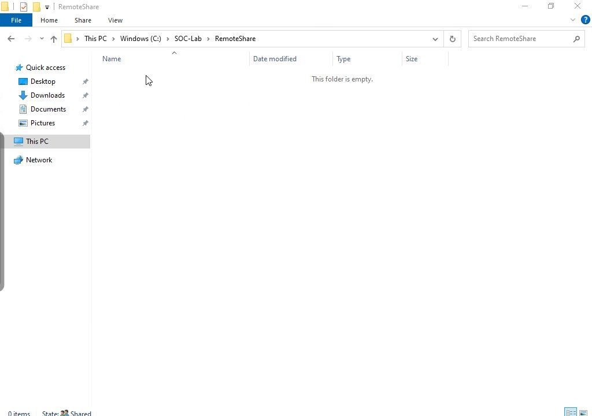
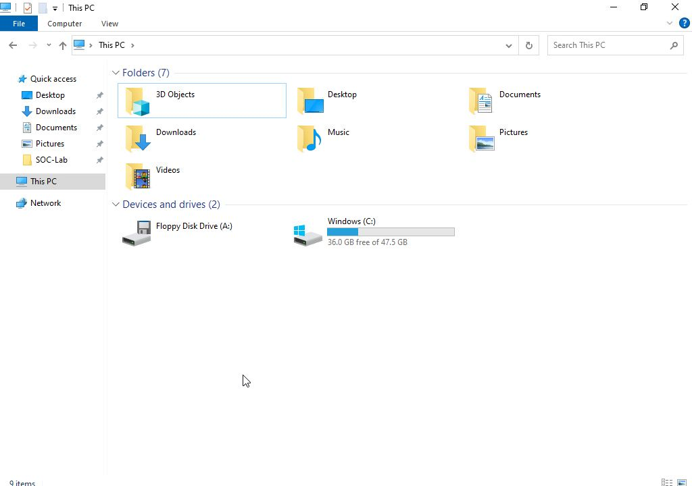

# Cleanup

After evidence preservation, the source and target copies of R04-transfer.txt were moved through local Explorer to their Windows Recycle Bins. The active test paths were absent, and the recoverable copies still matched the preserved 60-byte SHA256. The bins were not emptied.

The source Z mapping was disconnected through Explorer. No lab.ops RDP session, test mstsc client or lab.ops WinRM host remained. The one-off WinRM host had already terminated after returning the command result. Security logs were retained; no 1102 clear event occurred during the investigation. The alert schedule was stopped after its validation.

[Cleanup checks](results/cleanup-checks.csv) record the observations.
