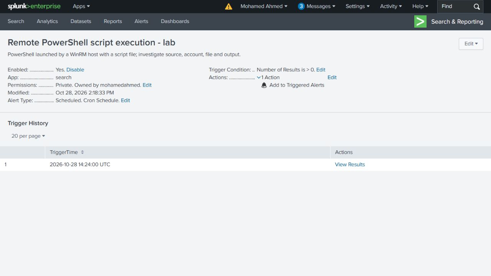
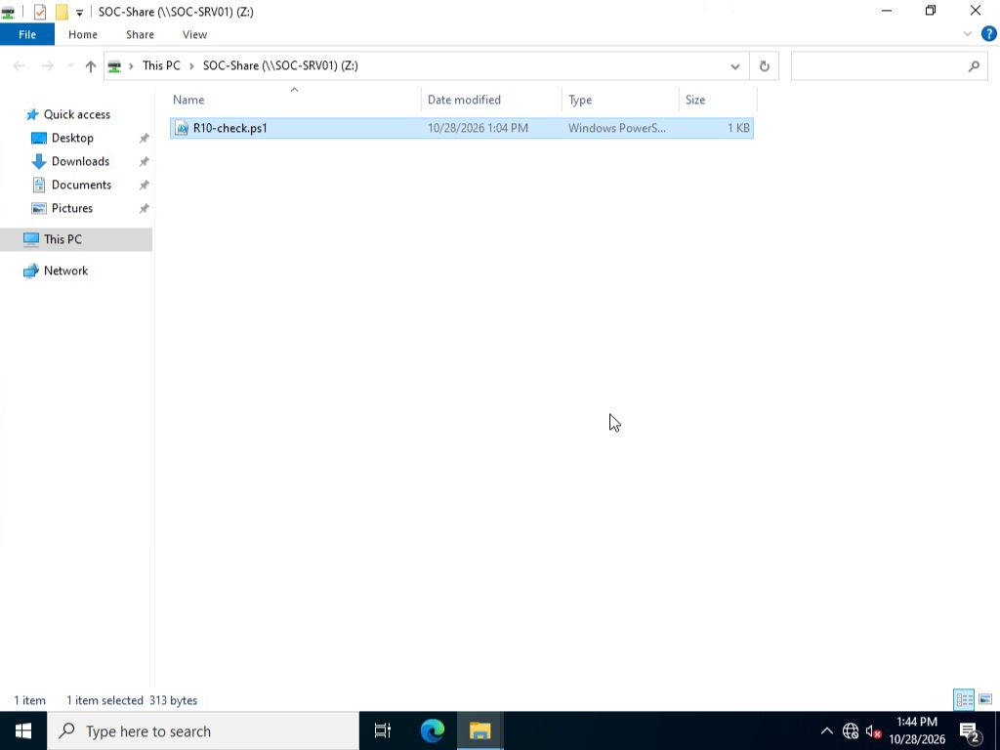
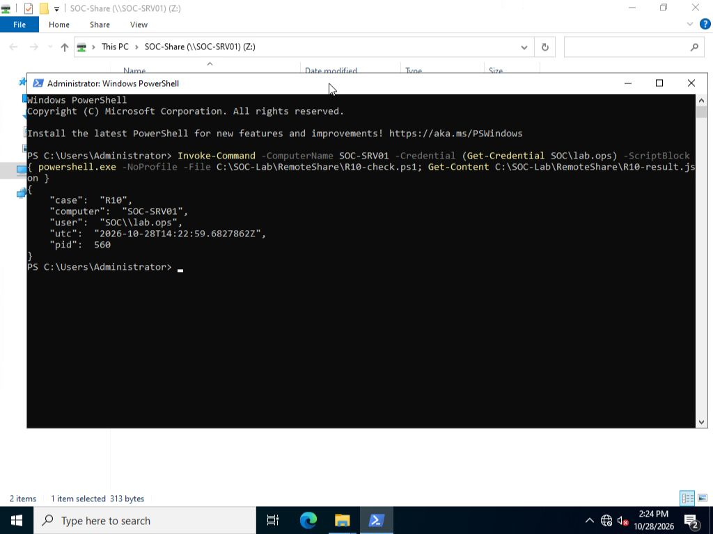
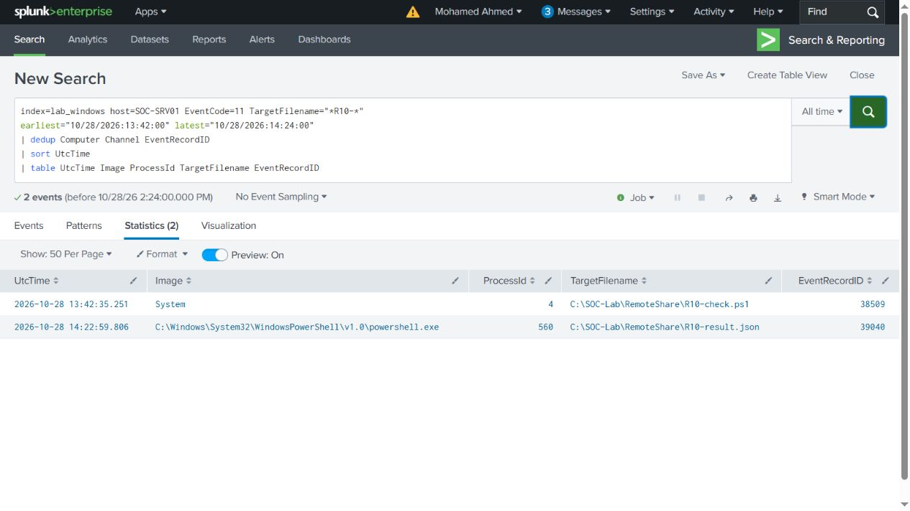
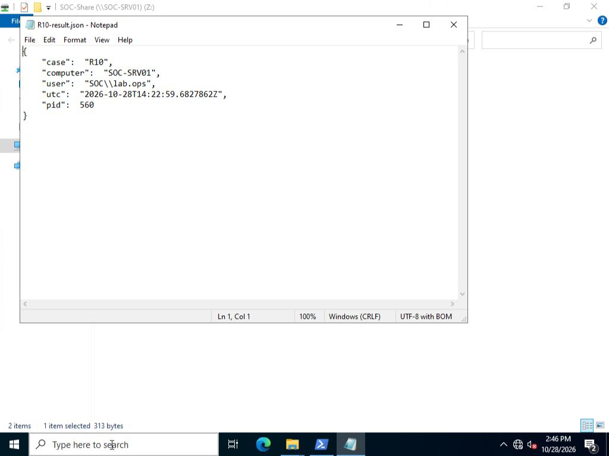

# Transferred script executed through WinRM

A scheduled Splunk alert identified PowerShell starting from `wsmprovhost.exe` on SOC-SRV01. The investigation linked the process to an earlier SMB script transfer from SOC-WS01 and verified the file it created on the target.

**Outcome:** successful remote execution of the transferred script as `SOC\lab.ops`. This was a controlled lateral movement emulation using an existing lab account and a harmless payload.



## What happened

1. Created [R10-check.ps1](artifacts/R10-check.ps1) in Notepad on SOC-WS01. It records the current computer, account, UTC time and process ID in a JSON file.
2. Opened `\\SOC-SRV01\SOC-Share` through Explorer using `SOC\lab.ops`, then copied the script. Source and target SHA256 values matched. The result file was absent after the copy.
3. Ran the same target file through one explicit WinRM command from the source PowerShell window.
4. Verified the [result file](artifacts/R10-result.json): `SOC-SRV01`, `SOC\lab.ops`, PID `560`, at `2026-10-28T14:22:59.6827862Z`.
5. Followed the alert back through the source connection, account ticket, target logon, parent process, script content and file creation.



```powershell
Invoke-Command -ComputerName SOC-SRV01 -Credential (Get-Credential SOC\lab.ops) -ScriptBlock { powershell.exe -NoProfile -File C:\SOC-Lab\RemoteShare\R10-check.ps1; Get-Content C:\SOC-Lab\RemoteShare\R10-result.json }
```



## Evidence chain

| Stage | UTC on 28 October 2026 | Original evidence |
|---|---|---|
| Source script saved | 13:04:54 | SOC-WS01 Sysmon 11/52721–52722, Notepad |
| Share authenticated | 13:37:14 | Source Security 4648/47468; target 4624/32041 and 5140/32043; DC 4768/77840 and 4769/77841 |
| Script copied | 13:42:35 | Target Security 5145/32123–32124; Sysmon 11/38509 |
| Source command submitted | 14:22:08 | SOC-WS01 PowerShell 4104/3570 |
| Account service ticket | 14:22:57 | SOC-DC01 Security 4769/78631: lab.ops, source .30, service SOC-SRV01$, status 0x0 |
| Explicit remote credentials | 14:22:57–14:23:00 | SOC-WS01 Security 4648/47914–47918, client PID 1476 |
| Source connections | 14:22:58 | SOC-WS01 Sysmon 3/53751–53753, destination .40:5985 |
| Target execution context | 14:22:57 | SOC-SRV01 Security 4624/32484, target-local LogonId 0x370a21 |
| WinRM host | 14:22:57 | Target Sysmon 1/39036, PID 3528; Security 4688/32487 |
| PowerShell child | 14:22:58 | Target Sysmon 1/39037, PID 560, parent PID 3528; Security 4688/32492 |
| Actual script content | 14:22:59 | Target PowerShell 4104/2951, path R10-check.ps1, execution PID 560 |
| Result created | 14:22:59 | Target Sysmon 11/39040, same process GUID and PID 560 |
| Alert triggered | 14:24:00 | Splunk Trigger History for Remote PowerShell script execution - lab |

The target child's `ParentProcessGuid` matches the WinRM host's `ProcessGuid`. The result-creation event has the child's same `ProcessGuid`. WinRM 91/214 identifies the PowerShell endpoint, PID 3528 and the lab.ops SID. These links distinguish execution from a file merely arriving on disk.

The source desktop was signed into local Administrator; the remote command explicitly supplied lab.ops. Source PID 1476 is identified by its process GUID and creation event 1/53375, since Windows can reuse process IDs. Multiple credential or connection records came from the one command, not separate manual submissions. The target logon address is `-`; source network records and the DC service ticket supply the source-address context.



## Detection and disposition

The [alert search](queries/R10-remote-script-alert.spl) selects PowerShell launched by a WinRM host with `-File`. It does not depend on the R10 filename or lab.ops account. It ran every minute over the last five minutes, triggered on more than zero results, and suppressed repeat notifications for 300 seconds. Only the internal Triggered Alerts action was configured.

The search returned zero events before execution. The scheduled alert triggered at 14:24 UTC after the new execution. The [execution search result](results/R10-script-execution.csv) identifies event 39037 and the transferred script command. The test settings and trigger reference are in [alert-test.json](results/alert-test.json). Scheduling was stopped after validation; trigger history was retained.

This behavior warrants investigation when the source, account or script is unexpected. In this lab, the known operator and harmless script explain the activity. The result is confirmed execution in an authorized attack emulation, with no credential-theft or malware claim. For an unapproved occurrence, preserve the script and logs, check account authorization and recent access, scope other hosts reached by the account, and escalate for endpoint containment and credential review.

## Comparison with the other cases

| Case | Observed result |
|---|---|
| R01–R02 | Authorized RDP access and session lifecycle |
| R03 | Share allowed for lab.ops and denied for lab.user5 |
| R04 | Text transferred and hashes matched; no execution |
| R05 | WinRM ran hostname and whoami; the text file was not executed |
| R10 | The copied script ran through WinRM and created a target result file |

The same protocols can carry administration or lateral movement. The useful distinction is the full sequence and its authorization, rather than treating every network logon as an attack.

## Searches and artifacts

Six short [investigation searches](queries/) cover arrival, execution, script content, source connections, target file creation and the domain service ticket. Every displayed result was checked against the original XML in [native/](native/). The [native index](results/native-event-index.csv) records host, channel, record ID and file hash.

The script is 313 bytes; source and target SHA256: `82f1b1430c4402282b3740e00a2a5b7472cad1f40ded8b785ad502d11813a8f0`. Result SHA256: `d0ceefbe6775c528ea2d232ca3fdb84861e14b175b09e0841d4fe6019b68ec3b`.


